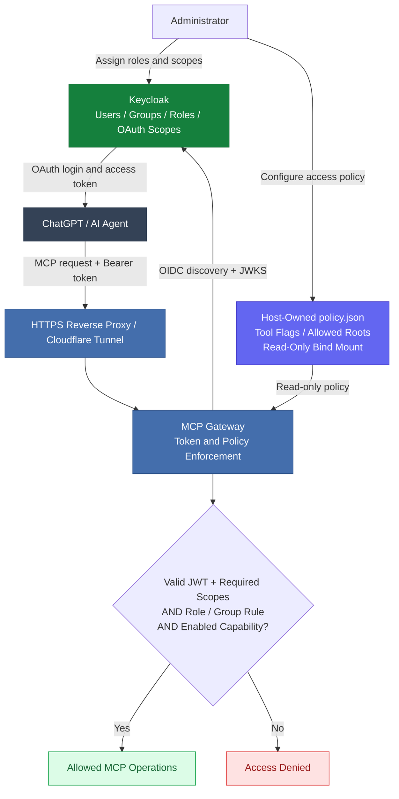

# ChatGPT + Keycloak MCP Gateway (security-first example)

A minimal, self-hosted OAuth-protected **Model Context Protocol (MCP) resource server**.
Uses Keycloak for OIDC/JWKS, with a stateless Streamable HTTP `/mcp` endpoint and
a read-only demo tool and disabled-by-default filesystem tools governed by a host-owned access policy. This is **not** copied from any production installation.

> **Status: reference implementation / local test project.**
> It has not been tested end-to-end with a real ChatGPT + Keycloak deployment.
> It does not implement all optional MCP features or all edge cases of the full
> Streamable HTTP transport specification. Do not treat it as audited infrastructure.

## What this demonstrates

- OAuth Protected Resource Metadata (RFC 9728), including the 401 challenge;
- independently configured HTTPS issuer and public MCP resource URL;
- OIDC discovery, signature verification against issuer JWKS (RS256 only);
- issuer, audience, expiry and strict OAuth scope checks;
- separate OAuth scopes from Keycloak realm/client roles (roles never imply scope);
- small stateless JSON-RPC endpoint with `initialize`, `ping`, `tools/list`,
  `tools/call`, notifications; a harmless `demo_ping` and a read-only
  `permissions_inspect` tool;
- Keycloak roles/groups + OAuth scopes + read-only host capability policy
  controlling optional `fs_read` and `fs_write` tools (both disabled by default);
- fail-closed behavior when Keycloak or JWKS is unavailable;
- Docker configuration binding only to loopback (publish TLS via your own tunnel/proxy).

## Security model

### Authorization architecture

Access is granted **only when both** the validated Keycloak access token and
the administrator-controlled local policy authorize the requested operation.
Filesystem operations additionally require an explicitly mounted, permitted
root and suitable operating-system permissions.

Keycloak remains the **authorization server**. This code only validates bearer
access tokens; it does **not** issue tokens, accept arbitrary ID tokens as login,
forward secrets, translate Keycloak roles into OAuth scopes, or run host commands.
The live policy is stored outside all AI-writable roots and mounted read-only.
See [Access Policy](docs/ACCESS_POLICY.md) for roles, groups and configuration.

## Local setup

1. Create a Keycloak realm and register a **public OAuth client** for ChatGPT
   (authorization-code + PKCE S256). Use the **exact redirect URI and client
   details shown in the ChatGPT MCP connection UI**; do not guess callbacks.
2. Configure Keycloak to issue access tokens containing the **audience** for
   this MCP API and the OAuth scope `mcp:read`. Check actual decoded access-token
   claims. A realm/client *role* named `mcp:read` is **not sufficient**.
3. Copy the sample environment file: `cp .env.example .env` and replace the
   example URLs/audience with your own. Never commit the real `.env`.
   Copy `config/policy.example.json` to an administrator-owned file, e.g.
   `/srv/mcp-policy/policy.json`, **outside ALL AI-editable directories**;
   keep it root-owned and read-only, and set `MCP_POLICY_HOST_FILE` accordingly.
   See `docs/ACCESS_POLICY.md` for the complete setup and role/group mapping.
4. Run `docker compose up --build -d`. The HTTP listener binds to
   `127.0.0.1:8000` only, for use by a **locally running** HTTPS reverse proxy or
   Cloudflare Tunnel process. If your proxy is containerized, use an isolated
   internal Docker network instead of opening the port publicly.
5. Point your trusted HTTPS tunnel/proxy to the app; the external MCP URL must
   equal `MCP_PUBLIC_URL` **including /mcp**. Example:
   `https://mcp.example.com/mcp`. Allow discovery at
   `/.well-known/oauth-protected-resource`.
6. In ChatGPT, configure the remote MCP URL and OAuth client details according
   to the connection UI. Verify 401 discovery, interactive login and tool call
   before connecting any real privileged tools.

**Do not copy Cloudflare credentials, Keycloak realm exports with users, or
nginx configuration from your production host.**

### Test locally (without contacting Keycloak)

    python -m pip install -r requirements-dev.txt
    python -m pytest -q
    python scripts/security_check.py

To inspect a public RFC 9728 endpoint:

    curl https://mcp.example.com/.well-known/oauth-protected-resource

To inspect unauthenticated challenge:

    curl -i -X POST https://mcp.example.com/mcp \
      -H 'Content-Type: application/json' \
      -d '{"jsonrpc":"2.0","id":1,"method":"tools/list"}'

Expected: 401 with WWW-Authenticate resource_metadata and scope. A token with
incorrect issuer, audience, expiry or scope MUST be rejected.

## Keycloak ↔ ChatGPT caveat (as of October 2026)

Keycloak's MCP integration guide documents **ChatGPT CIMD metadata
incompatibility**. In particular ChatGPT advertises
`token_endpoint_auth_methods_supported` while Keycloak expects
`token_endpoint_auth_method`. This template deliberately does **not**
synthesize OAuth registration endpoints or weaken validation. Use a properly
pre-registered client when supported by your ChatGPT setup, or a separately
reviewed, standards-compliant compatibility layer.

References:

- https://www.keycloak.org/securing-apps/mcp-authz-server
- https://developers.openai.com/plugins/build/auth
- https://modelcontextprotocol.io/specification/2025-11-25/basic/authorization
- https://www.rfc-editor.org/rfc/rfc9728

## Scope and limitations

This is a **standalone sanitized implementation**, not a feature-complete
multiplexing gateway. No SSH, Docker socket, shell execution, private IP
addresses, internal hostnames, persistent secrets, production configuration,
or connection to the original environment are included. Optional constrained
filesystem read/write tools are disabled by default, require explicit Keycloak
claims and host policy, and cannot update the live policy file. Advanced MCP features,
SSE streaming and server-initiated messages are intentionally excluded.

Before publishing or using in production, independently review the changes,
run Gitleaks/TruffleHog against **the whole history**, validate Keycloak
authorization-code + PKCE behavior, exercise real ChatGPT OAuth connectivity,
add observability and rate limits at your proxy, and run dependency/security
scanning. See SECURITY.md.

## License

MIT. This example is independent of Keycloak/OpenAI/MCP maintainers and has
no official affiliation.
