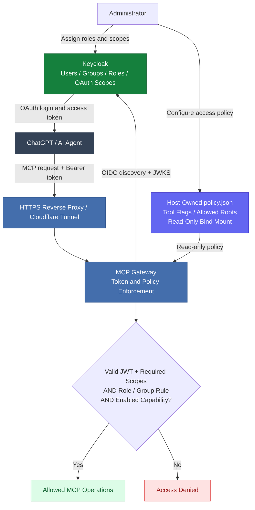

# ChatGPT + Keycloak MCP Gateway

**I use ChatGPT to work with files and self-hosted tools, while keeping access under my control.**

In my running setup, ChatGPT can inspect projects, edit files in approved directories, and invoke explicitly exposed server-side tools. It can also prepare implementation plans for other coding agents, so I can review the work in ChatGPT and hand off the coding when needed.

Keycloak handles sign-in and role/group membership. A separate, administrator-owned policy controls which MCP tools are available and where they may read or write.

### Tested with ChatGPT Plus in regular Chat mode

My **full, self-hosted connector is running and I have used it successfully with ChatGPT Plus and Keycloak**. I use it from regular **Chat mode**; **Work mode is not required** for my setup. Availability may vary by plan and account.

If you want to use the normal Chat experience rather than the separate Work/Codex agentic allowance, stay in **Chat mode**. This does **not** mean unlimited or zero-token usage: normal ChatGPT plan and feature limits still apply. The gateway itself does not need an OpenAI API key or make paid OpenAI API inference requests.

### What is included in this repository?

This is a **sanitized, deliberately smaller example** of the architecture behind my working integration, not a copy of its full production toolset. It includes OAuth token validation, Keycloak role/group checks, an administrator-controlled access policy, `demo_ping`, `permissions_inspect`, and optional `fs_read` / `fs_write` tools (disabled by default).

My **live connector works**; the **standalone public example** has automated tests but has **not been separately validated end-to-end against a fresh ChatGPT + Keycloak deployment**. Extra server operations must be implemented and granted explicitly. This code is not a production security audit or a drop-in replacement for the full connector.

## Set it up with a coding agent (Codex, Cursor, or Claude Code)

Clone this repository on the **server where you want to run the gateway**, open
the repository in your coding agent, and paste the prompt below. Give the agent
a terminal and access to a disposable/test Keycloak realm or a specifically
approved existing realm. You will still need to supply your real HTTPS
hostnames, complete any required ChatGPT browser login, and approve sensitive
infrastructure changes. **This is a setup playbook, not an unattended installer.**

<details>
<summary><strong>Copy/paste: end-to-end setup prompt for a coding agent</strong></summary>

```text
You are configuring this repository as a self-hosted, Keycloak-protected
MCP server for ChatGPT. Work in the checked-out repository and on the
designated deployment host. Aim for a verified working integration, not
just a green unit test suite.

First inspect README.md, SECURITY.md, docs/KEYCLOAK_SETUP.md,
docs/ACCESS_POLICY.md, .env.example, docker-compose.yml,
config/policy.example.json, and the Python implementation.

MY INPUTS (ask only for values you cannot discover safely):
- Public MCP HTTPS hostname (the endpoint must end in /mcp).
- Existing Keycloak HTTPS issuer + admin access, OR permission to
  provision a separate test instance/realm.
- Preferred trusted reverse proxy or tunnel (existing Cloudflare Tunnel
  or HTTPS reverse proxy are fine).
- Whether I only want read/inspection or explicitly authorize file
  writes; exact approved host directories if any.
- My ChatGPT account's currently supported custom MCP setup method and
  the EXACT OAuth redirect URI/client details shown by its UI.

GOALS AND NON-NEGOTIABLE SAFETY RULES
- Keep real secrets, tokens, private realm exports, .env, and admin
  configuration out of Git commits, terminal transcripts, PRs and
  final chat summaries. Never print complete tokens or credentials.
- Never copy production configuration into this public example.
- Do not change an unrelated running Keycloak instance, proxy, DNS,
  firewall, or container stack without my explicit approval.
- Default to READ_ACCESS=false, WRITE_AND_ACCESS=false, and empty roots.
  Do not grant broad / or /home access, mount a Docker socket, or create
  shell/SSH execution tools to work around missing permissions.
- The live policy belongs in an admin-owned directory OUTSIDE every
  AI-writable directory. Mount it read-only and keep all service
  credentials inaccessible to MCP file tools.
- No wildcard redirects/CORS, disabled JWT checks, token forwarding to
  untrusted services, hardcoded OAuth secrets, or permissive fallbacks.
- If the current ChatGPT plan/UI or Keycloak registration method cannot
  support the flow, explain the exact blocker. Never claim success
  without observing an actual authorized ChatGPT tool call.

INSTALLATION AND VALIDATION PROCEDURE
1. Inspect Linux architecture, Docker/Compose availability, free ports,
   existing reverse proxy/tunnel and Keycloak deployment. Check
   repository status and record the initial state. Run Python tests and
   validate Docker Compose before changing infrastructure.

2. Set up a dedicated Keycloak realm/client for this MCP resource (or
   reuse an explicitly approved test realm). Configure authorization
   code flow + PKCE S256, exact ChatGPT-provided redirect URI, and strict
   trusted origins. Configure an access-token audience exactly equal to
   MCP_PUBLIC_URL, plus the OAuth scope mcp:read. For writes, also
   configure mcp:write and assign an explicit mcp-writer role or
   /ai-writers group. For reads, use mcp-reader or /ai-readers. If
   needed, map realm_access.roles, resource_access[client_id].roles and
   groups into the signed ACCESS token; roles are NOT OAuth scopes.
   Confirm the token includes expected iss, aud, exp, typ and scope.

3. Check the installed Keycloak release and CURRENT ChatGPT client
   registration behavior. Read:
   https://www.keycloak.org/securing-apps/mcp-authz-server
   https://help.openai.com/en/articles/12584461-connecting-custom-mcp-servers-in-chatgpt
   Keycloak documents a ChatGPT CIMD metadata incompatibility in some
   versions. Prefer a supported pre-registered OAuth client when the
   ChatGPT UI allows it. If an adapter or custom client-policy
   executor is necessary, explicitly identify it, obtain my approval,
   implement/test it separately, and DO NOT bypass OAuth validation
   or pretend that a missing compatibility layer already exists.

4. Create a private .env from .env.example with the real public URL,
   issuer, audience and optional trusted HTTPS origins. Keep it
   untracked. Create an administrator-owned policy from
   config/policy.example.json outside the checkout and outside ALL
   AI-writable roots, for example /srv/mcp-policy/policy.json.
   The source path named in MCP_POLICY_HOST_FILE must exist. Make the
   live policy readable to UID 10001 but not writable by the service;
   use a bind mount with read_only=true.

5. If I explicitly request filesystem tools, enable only fs_read
   and/or fs_write and only for named directories. Set READABLE_ROOTS
   and/or EDITABLE_ROOTS to matching ABSOLUTE CONTAINER paths, define
   explicit tool role/group constraints, and add only the corresponding
   host-to-container mounts. A writable root MUST be mounted RW and
   writable by container UID 10001. Keep the policy path, .git, .env,
   credentials and Keycloak data inaccessible to both read and write
   tools. Start with read-only privileges where possible.

6. Configure public HTTPS for the MCP URL and Keycloak issuer. Keep
   the gateway's Docker port bound to 127.0.0.1 by default, or use a
   dedicated private Docker network for a containerized proxy/tunnel.
   Preserve the /.well-known/oauth-protected-resource endpoint and
   the exact /mcp resource URL. Only expose what the MCP client needs.
   Ensure outbound OIDC discovery/JWKS to the trusted issuer works.

7. Validate: docker compose config; docker compose up --build -d;
   container health; HTTP GET /health; protected-resource metadata
   with the exact resource URI and issuer; unauthenticated POST /mcp
   returning 401 with WWW-Authenticate; unexpected Origin returning
   403; unsupported MCP-Protocol-Version returning 400. Verify logs
   without leaking JWTs, secrets or private infrastructure details.

8. Ask me to connect the custom MCP server in the currently available
   ChatGPT interface and complete the OAuth browser authorization.
   Do not invent UI labels or redirect URIs: use values displayed to
   me. Verify REAL authenticated initialize, tools/list,
   demo_ping and permissions_inspect calls from ChatGPT in regular
   Chat mode where my plan supports this. Write/modify actions may
   require additional account/workspace support and confirmation.
   If applicable, validate the refresh-token flow (offline_access
   and provider support) without dumping tokens.

9. Perform NEGATIVE tests. Confirm that an expired/invalid/wrong-
   audience token fails, missing mcp:read fails, a missing role/group
   prevents file access, missing mcp:write prevents writes, an
   unapproved path or symlink escape fails, and the live policy
   cannot be changed by any exposed MCP tool. Never run destructive
   tests against production or personal files; use a disposable
   workspace and test identity.

10. Finish with a concise result: exact public MCP URL, components
    deployed, which tools are enabled, which roles/scopes authorize
    them, tests performed with PASS/FAIL, any manual ChatGPT actions
    remaining, compatibility gaps, rollback commands, and files
    changed. Do not claim end-to-end success until the OAuth login
    and actual ChatGPT tool calls have completed. Do not push to a
    public repository or commit secrets.

If something is not implemented by this minimal template, clearly
distinguish (a) what already works, (b) what you safely implemented
and tested, and (c) what still needs my approval or manual action.
```

</details>

**Expected result:** a functioning read-only MCP connection first, with
optional filesystem access granted explicitly by Keycloak roles/scopes,
the private policy file, and Docker mounts. The public template does not
include the full tool collection of my private installation.

## What this demonstrates

- OAuth Protected Resource Metadata (RFC 9728), including the 401 challenge;
- independently configured HTTPS issuer and public MCP resource URL;
- OIDC discovery, signature verification against issuer JWKS (RS256 only);
- issuer, audience, expiry and strict OAuth scope checks;
- separate OAuth scopes from Keycloak realm/client roles (roles never imply scope);
- small stateless JSON-RPC endpoint with `initialize`, `ping`, `tools/list`,
  `tools/call`, notifications; a harmless `demo_ping` and a read-only
  `permissions_inspect` tool;
- Keycloak roles/groups + OAuth scopes + read-only host capability policy
  controlling optional `fs_read` and `fs_write` tools (both disabled by default);
- fail-closed behavior when Keycloak or JWKS is unavailable;
- Streamable HTTP transport checks (`Origin`, `MCP-Protocol-Version`),
  OAuth scope challenges and authenticated GET returning HTTP 405 without SSE;
- Docker configuration binding only to loopback (publish TLS via your own tunnel/proxy).

## Security model

### Authorization architecture



Access is granted **only when both** the validated Keycloak access token and
the administrator-controlled local policy authorize the requested operation.
Filesystem operations additionally require an explicitly mounted, permitted
root and suitable operating-system permissions.

Keycloak remains the **authorization server**. This code only validates bearer
access tokens; it does **not** issue tokens, accept arbitrary ID tokens as login,
forward secrets, translate Keycloak roles into OAuth scopes, or run host commands.
The live policy is stored outside all AI-writable roots and mounted read-only.
See [Access Policy](docs/ACCESS_POLICY.md) for roles, groups and configuration.

## Local setup

1. Create a Keycloak realm and register a **public OAuth client** for ChatGPT
   (authorization-code + PKCE S256). Use the **exact redirect URI and client
   details shown in the ChatGPT MCP connection UI**; do not guess callbacks.
2. Configure Keycloak to issue access tokens containing the **audience** for
   this MCP API and the OAuth scope `mcp:read`. Check actual decoded access-token
   claims. A realm/client *role* named `mcp:read` is **not sufficient**.
3. Copy the sample environment file: `cp .env.example .env` and replace the
   example URLs/audience with your own. Never commit the real `.env`.
   Browser-based clients that send an `Origin` header must use an exact allowed
   HTTPS origin. List any additional trusted origins in `MCP_ALLOWED_ORIGINS`
   (JSON array); leave it `[]` for server-to-server clients without Origin.
   Copy `config/policy.example.json` to an administrator-owned file, e.g.
   `/srv/mcp-policy/policy.json`, **outside ALL AI-editable directories**;
   keep it root-owned and read-only, and set `MCP_POLICY_HOST_FILE` accordingly.
   See `docs/ACCESS_POLICY.md` for the complete setup and role/group mapping.
4. Run `docker compose up --build -d`. The HTTP listener binds to
   `127.0.0.1:8000` only, for use by a **locally running** HTTPS reverse proxy or
   Cloudflare Tunnel process. If your proxy is containerized, use an isolated
   internal Docker network instead of opening the port publicly.
5. Point your trusted HTTPS tunnel/proxy to the app; the external MCP URL must
   equal `MCP_PUBLIC_URL` **including /mcp**. Example:
   `https://mcp.example.com/mcp`. Allow discovery at
   `/.well-known/oauth-protected-resource`.
6. In ChatGPT, configure the remote MCP URL and OAuth client details according
   to the connection UI. Verify 401 discovery, interactive login and tool call
   before connecting any real privileged tools.

**Do not copy Cloudflare credentials, Keycloak realm exports with users, or
nginx configuration from your production host.**

### Test locally (without contacting Keycloak)

    python -m pip install -r requirements-dev.txt
    python -m pytest -q
    python scripts/security_check.py

The test suite also scans all reachable local Git history blobs for selected
high-confidence secret patterns. This is not a substitute for an independent
Gitleaks/TruffleHog audit before publishing.

To inspect a public RFC 9728 endpoint:

    curl https://mcp.example.com/.well-known/oauth-protected-resource

To inspect unauthenticated challenge:

    curl -i -X POST https://mcp.example.com/mcp \
      -H 'Content-Type: application/json' \
      -d '{"jsonrpc":"2.0","id":1,"method":"tools/list"}'

Expected: 401 with WWW-Authenticate resource_metadata and scope. A token with
incorrect issuer, audience, expiry or scope MUST be rejected.

## Keycloak ↔ ChatGPT caveat (as of October 2026)

Keycloak's MCP integration guide documents **ChatGPT CIMD metadata
incompatibility**. In particular ChatGPT advertises
`token_endpoint_auth_methods_supported` while Keycloak expects
`token_endpoint_auth_method`. This template deliberately does **not**
synthesize OAuth registration endpoints or weaken validation. Use a properly
pre-registered client when supported by your ChatGPT setup, or a separately
reviewed, standards-compliant compatibility layer.

References:

- https://www.keycloak.org/securing-apps/mcp-authz-server
- https://developers.openai.com/plugins/build/auth
- https://modelcontextprotocol.io/specification/2025-11-25/basic/authorization
- https://www.rfc-editor.org/rfc/rfc9728

## Scope and limitations

This is a **standalone sanitized implementation**, not a feature-complete
multiplexing gateway. No SSH, Docker socket, shell execution, private IP
addresses, internal hostnames, persistent secrets, production configuration,
or connection to the original environment are included. Optional constrained
filesystem read/write tools are disabled by default, require explicit Keycloak
claims and host policy, and cannot update the live policy file. Advanced MCP features,
SSE streaming and server-initiated messages are intentionally excluded.

Before publishing or using in production, independently review the changes,
run Gitleaks/TruffleHog against **the whole history**, validate Keycloak
authorization-code + PKCE behavior, exercise real ChatGPT OAuth connectivity,
add observability and rate limits at your proxy, and run dependency/security
scanning. See SECURITY.md.

## License

MIT. This example is independent of Keycloak/OpenAI/MCP maintainers and has
no official affiliation.
